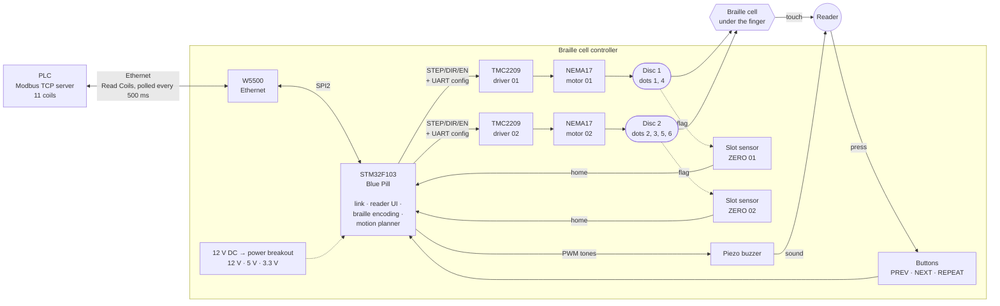
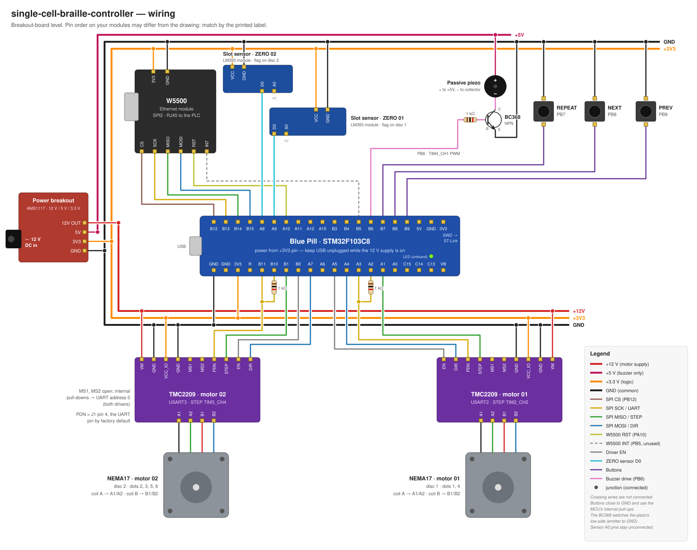

# Single-cell braille controller

An open-hardware, **single-cell refreshable braille display** that adds a
tactile output to an industrial human–machine interface (HMI). It connects to a
PLC over the existing Ethernet network as a **Modbus TCP client**. It then presents the machine's status
signals in braille, one short label and value at a time.

The firmware, wiring, and (soon) mechanical files are all in this repository.
The design and its functional characterization are described in the paper
[*An Open Hardware Single-Cell Braille Display for
Industrial HMI: Design and Functional
Characterization](#publication).

## Why

Industrial HMIs are almost entirely graphical. That excludes visually impaired
operators, even from roles where vision is not critical to safety. Commercial
refreshable braille displays don't close this gap:

- They use one piezoelectric bender per dot, driven at 100–300 V, at about
  US$35 per cell, so a 40- or 80-cell line is expensive.
- They expose only consumer interfaces, with no support for industrial
  protocols.
- Their designs are proprietary, so adapting them is a model-by-model licensing
  effort.

Industrial HMI content is different from continuous text. It is short and
codified: alarm identifiers, states, setpoints, and mnemonics. One character at
a time is enough. Earlier studies found that blind readers recognize words
shown one character at a time on a rotating embossed disc as accurately as on
paper braille; the cost is reading speed. A single cell, in turn, makes a
simple and robust actuator practical. Because the device is purpose-built, it
can speak an industrial protocol natively.

## What this project contributes

- **A two-disc cell.** It follows the sliding-contact design of Thomas and
  Prabhakar (IEEE HAPTICS 2024). Only two parts move, the dots are permanent
  embossed features, and the reading force is carried by the disc body instead
  of an actuator.
- **A positional binary dot mapping**, which the original design leaves
  unspecified. A character's dot pattern directly gives each disc's angle, and
  the space character sits at the mechanical home position.
- **Off-the-shelf modules only, and no high-voltage rail.** The prototype's
  parts cost about **US$33**, and a single 12 V supply is the highest voltage in
  the device.
- **A native Modbus TCP client.** It polls the PLC directly over the plant
  network.
- **Validation on a real station.** It was tested on an SMT conveyor station
  controlled by an HI Tecnologia RION 5 HIO130 PLC. A signal change reaches the
  device within about **1.5 s**, and a full package of 11 signals is read in
  about **36 s**. Both fit within the station's one-minute board cycle.

This README covers how the device works, the hardware and its wiring, building
and flashing the firmware, and using the device. The detailed firmware guides
are in [`docs/`](docs/README.md).

---

## How it works

A braille cell has six dots in two columns: 1-2-3 on the left, 4-5-6 on the
right. Instead of actuating each dot, the cell is split between two embossed
discs placed side by side and read together under one finger:

| Disc   | Driven by | Dots it carries                        | Embossed groups                                     |
| ------ | --------- | -------------------------------------- | --------------------------------------------------- |
| Disc 1 | Motor 01  | 1 and 4 (top row)                      | Its 4 combinations, repeated 4 times around the rim |
| Disc 2 | Motor 02  | 2, 3, 5 and 6 (middle and bottom rows) | All 16 combinations, once each                      |

Both discs carry 16 groups at a 22.5° pitch, and together they can show all
2⁶ = 64 braille characters.

**Mapping.** Each dot counts as one binary digit (raised = 1, flat = 0). Each
disc's position index comes from its own dots, with the bit weight increasing
with the dot number:

```
n1 = d1 + 2·d4                    (0..3)     θ1 = 22.5° × n1
n2 = d2 + 2·d3 + 4·d5 + 8·d6      (0..15)    θ2 = 22.5° × n2
```

Index 0 on both discs means all dots flat, which is the space character. It is
placed at the angular origin, so the mapping's zero is the same as the
mechanical zero.

**Homing.** Stepper control is open-loop, so a tab on each disc interrupts a
slotted IR sensor to mark that zero. After homing at power-up, the cell already
shows a space, and every character is commanded as an absolute angle, so
position errors never accumulate.

**Motion.** 22.5° is 12.5 full steps of a 1.8° motor, so the TMC2209 drivers run
at 1/8 microstepping. That makes every position exactly 100 microsteps. Both
discs move at the same time at one revolution per second, always along the
shorter path, so any character change takes at most 0.5 s. See
[docs/08](docs/08-motion-and-homing.md).

### Reading a machine, one value at a time

Every 500 ms the device sends one Read Coils request to the PLC and receives the
whole package of signals: in the case study, 11 coils. Each response is checked
against its request and discarded if any field disagrees. Modbus gives a server
no way to push data, so the device detects a change by comparing each valid
response with the package the reader currently holds.

One cell shows one glyph at a time, so each signal is presented as a sequence:

1. its **label**, one or two braille letters (Portuguese mnemonics, such as `V`
   for *verde*, the green lamp), each held for 1.5 s, then
2. its **value**: all dots flat for `false`, all dots raised for `true`.

No label letter uses either of those two patterns, so the value always marks the
end of the sequence. The cell then stays on the value, so after each button
press the reader's finger ends on the answer.

| Button     | Action                                                                                                |
| ---------- | ----------------------------------------------------------------------------------------------------- |
| **NEXT**   | Show the next signal. Before the first read, or past the last signal, it asks the PLC for fresh data. |
| **PREV**   | Show the previous signal.                                                                             |
| **REPEAT** | Show the current signal again.                                                                        |

The buzzer plays five distinct sounds: request sent, data received, newer data
waiting, link fault, and "nothing there". The fault and "newer data" sounds are
rate-limited. Changes that happen during a read are not queued: one slot holds
the newest package, so the operator never has to work through a backlog of
outdated values. See [docs/10](docs/10-reader-ui-and-buzzer.md).

### Block diagram



---

## Hardware

### Bill of materials

| Qty | Part                                            | Unit cost (US$) | Notes                                                              |
| --- | ----------------------------------------------- | --------------- | ------------------------------------------------------------------ |
| 1   | **Blue Pill** (STM32F103C8T6)                   | 3.00            | Cortex-M3, 64 KB flash, 48 MHz system clock from the 8 MHz crystal |
| 1   | **W5500 Ethernet module**                       | 3.70            | SPI breakout with RJ45; hardwired TCP/IP stack                     |
| 2   | **TMC2209 breakout** (StepStick format)         | 3.00            | Configured over single-wire UART, moved over STEP/DIR              |
| 2   | **NEMA17 stepper motor**                        | 7.50            | One per disc                                                       |
| 2   | **LM393 IR slot sensor module** (VCC/GND/D0/A0) | 1.40            | Homing; only the digital D0 output is used                         |
| 1   | **Passive piezo buzzer**                        | 0.13            | Must be passive: the firmware generates the tones with PWM; driven through a BC368 (below) |
| 3   | **Momentary push button**                       | 0.03            | PREV, NEXT, REPEAT                                                 |
| 1   | **AMS1117 power breakout with DC barrel jack**  | 2.00            | Passes 12 V through and regulates 5 V and 3.3 V rails              |
|     | **Total** (as reported in the paper)            | **≈ 32.70**     |                                                                    |

Also needed, not counted in the total above:

- three **1 kΩ resistors**: one per TMC2209 between the MCU's TX and the
  driver's PDN pin, and one in series with the buzzer transistor's base;
- one **BC368 NPN transistor** that switches the buzzer from the 5 V rail;
- a **12 V DC power supply** sized for both motors (≥ 2 A is a comfortable
  margin);
- an **ST-Link V2** (or compatible) for flashing and debugging over SWD;
- perfboard and wires.

### Power

```
12 V DC adapter ──► barrel jack on the AMS1117 power breakout
                      ├── 12 V ──► VM of both TMC2209 (motor supply)
                      ├── 5 V ───► buzzer + (switched by the BC368)
                      └── 3.3 V ─► Blue Pill 3V3 pin, W5500, TMC2209 VCC_IO,
                                   slot sensors
GND is common to every board.
```

> [!WARNING]
> **The AMS1117 gets warm.** It is a linear regulator, so it dissipates
> roughly (12 V − 3.3 V) × load current as heat. The W5500 alone draws about
> 130 mA, so expect around 1 W. Give it airflow, or swap in a buck converter
> for long-term use.

> [!CAUTION]
> **Do not plug in the Blue Pill's USB while the 12 V supply is on.** The board
> is powered through its 3V3 pin. USB would feed the board's own 3.3 V regulator
> at the same time, so two regulators would drive the same rail. The default
> firmware does not use the USB port anyway.

### Wiring



Breakout boards from different makers order their pins differently, so **wire by
the printed label, not by position**. The full pin map:

| Blue Pill pin | Connects to                              | Function                                                |
| ------------- | ---------------------------------------- | ------------------------------------------------------- |
| PB12          | W5500 **CS** (SCS)                       | SPI2 chip select, driven by software                    |
| PB13          | W5500 **SCK**                            | SPI2 clock                                              |
| PB14          | W5500 **MISO**                           | SPI2 data, module → MCU                                 |
| PB15          | W5500 **MOSI**                           | SPI2 data, MCU → module                                 |
| PA10          | W5500 **RST**                            | Reset, active low                                       |
| PB5           | W5500 **INT**                            | Wired, but intentionally unused by the firmware         |
| PA2           | TMC2209 #1 **PDN** through **1 kΩ**      | USART2 TX                                               |
| PA3           | TMC2209 #1 **PDN** (direct)              | USART2 RX                                               |
| PA1           | TMC2209 #1 **STEP**                      | TIM2_CH2 pulse train                                    |
| PA4           | TMC2209 #1 **DIR**                       |                                                         |
| PA5           | TMC2209 #1 **EN**                        | Active low                                              |
| PB10          | TMC2209 #2 **PDN** through **1 kΩ**      | USART3 TX                                               |
| PB11          | TMC2209 #2 **PDN** (direct)              | USART3 RX                                               |
| PB1           | TMC2209 #2 **STEP**                      | TIM3_CH4 pulse train                                    |
| PA7           | TMC2209 #2 **DIR**                       |                                                         |
| PB0           | TMC2209 #2 **EN**                        | Active low                                              |
| PA9           | Slot sensor ZERO 01 **D0**               | High while the flag is in the slot (internal pull-down) |
| PA8           | Slot sensor ZERO 02 **D0**               | High while the flag is in the slot (internal pull-down) |
| PB6           | **1 kΩ** → BC368 **base** (buzzer driver) | TIM4_CH1 PWM                                            |
| PB7           | Button **REPEAT** (other leg to GND)     | Internal pull-up                                        |
| PB8           | Button **NEXT** (other leg to GND)       | Internal pull-up                                        |
| PB9           | Button **PREV** (other leg to GND)       | Internal pull-up                                        |
| PC13          | Onboard LED                              | Fault blink codes, no wiring needed                     |
| 3V3 / GND     | 3.3 V rail / GND                         | Board power                                             |

Other connections:

- **TMC2209 MS1 and MS2 → GND** on both drivers. This sets UART address 0;
  each driver has its own UART, so both can use the same address.
- **TMC2209 VM → 12 V, VCC_IO → 3.3 V**, and both GND pins → GND. The
  BIGTREETECH TMC2209 V1.2 module has two pins labelled PDN; the UART is on
  J1 pin 4 by factory default (a solder bridge selects it).
- **Buzzer driver:** BC368 emitter → GND, collector → buzzer −, buzzer + → 5 V.
  PB6 drives the base through 1 kΩ, so a high PB6 turns the transistor on.
- **Motor coils:** coil A → A1/A2, coil B → B1/B2. Wire colors vary between
  motors, so find the pairs with a multimeter (the two wires of one coil show a
  few ohms between them).
- **Slot sensors:** VCC → 3.3 V, GND → GND, A0 not connected.

### Mechanical design

The disc geometry is reproduced from Thomas and Prabhakar. The discs are about
45.8 mm in diameter, which gives roughly 9 mm of arc between neighboring groups.
That is more than the 6.1–7.6 mm braille cell spacing, so two neighboring groups
are never felt as a single cell. The dot dimensions follow the standard braille
specification and are fixed when the disc is printed.

The enclosure, discs, and actuator assembly (`.step` files) will be published in
`hardware/enclosure/`. Until then, the firmware's assumptions about the
mechanics (disc positions, the homing tab, rotation direction) are documented in
[docs/08](docs/08-motion-and-homing.md).

---

## Building the firmware

### Required tools

| Tool                                                                                                                 | Version     | Purpose                                                                     |
| -------------------------------------------------------------------------------------------------------------------- | ----------- | --------------------------------------------------------------------------- |
| [Arm GNU Toolchain](https://developer.arm.com/downloads/-/arm-gnu-toolchain-downloads) (`arm-none-eabi-gcc`)         | 13.x tested | Cross-compiler                                                              |
| [CMake](https://cmake.org/)                                                                                          | ≥ 3.22      | Build system (uses `CMakePresets.json`)                                     |
| [Ninja](https://ninja-build.org/)                                                                                    | any recent  | Generator used by the presets                                               |
| [STM32CubeProgrammer](https://www.st.com/en/development-tools/stm32cubeprog.html) or [OpenOCD](https://openocd.org/) |             | Flashing over SWD                                                           |
| `gcc` + `make` (host)                                                                                                |             | Optional: unit tests on your PC                                             |
| Python 3                                                                                                             |             | Optional: PLC simulator in `tools/`                                         |
| [STM32CubeMX](https://www.st.com/en/development-tools/stm32cubemx.html)                                              |             | Optional: only to change the pinout in `single-cell-braille-controller.ioc` |

The **STM32 VS Code extension** (STM32Cube for VS Code) installs a matching
CMake, Ninja and toolchain as "bundles". If `CUBE_BUNDLE_PATH` is set, the
toolchain file [`cmake/gcc-arm-none-eabi.cmake`](cmake/gcc-arm-none-eabi.cmake)
uses that toolchain automatically. Otherwise it uses the `arm-none-eabi-gcc` on
your `PATH`.

### Configure and build

```bash
git clone https://github.com/alexbatista/single-cell-braille-controller.git
cd single-cell-braille-controller

cmake --preset Debug          # or: Release
cmake --build --preset Debug
```

The firmware is written to `build/Debug/single-cell-braille-controller.elf`.

#### Build variants

The input source is chosen when you configure the build:

| `BRAILLE_INPUT`    | What it builds                                                                                                      |
| ------------------ | ------------------------------------------------------------------------------------------------------------------- |
| `MODBUS` (default) | The PLC reader described above: W5500 + buttons + buzzer                                                            |
| `USB_CDC`          | Bench variant: type a character into a USB virtual COM port and the cell renders it ([docs/06](docs/06-usb-cdc.md)) |

```bash
cmake --preset Debug -DBRAILLE_INPUT=USB_CDC
cmake --build --preset Debug
```

The value is case-sensitive, and an invalid value stops the configure step.

### Flash

Connect the ST-Link to the Blue Pill's SWD header (3V3, SWDIO, SWCLK, GND),
then flash with either tool:

```bash
# STM32CubeProgrammer
STM32_Programmer_CLI -c port=SWD -w build/Debug/single-cell-braille-controller.elf -v -rst

# or OpenOCD
openocd -f interface/stlink.cfg -f target/stm32f1x.cfg \
        -c "program build/Debug/single-cell-braille-controller.elf verify reset exit"
```

VS Code users can use the launch configurations in [`.vscode/launch.json`](.vscode/launch.json)
to flash and debug in one step.

---

## Using it

### 1. Point it at your network and PLC

All deployment settings are in [`App/Inc/plc_config.h`](App/Inc/plc_config.h).
There is no runtime configuration: edit the file and reflash.

| Setting                    | Default                                                      |
| -------------------------- | ------------------------------------------------------------ |
| Device IP / mask / gateway | `10.0.0.50` / `255.255.255.0` / `10.0.0.1` (static, no DHCP) |
| Device MAC                 | `00:08:DC:11:22:33`                                          |
| PLC address                | `10.0.0.204`, port **503**, unit id 1                        |
| Package                    | 11 coils starting at address 0, read with function code 0x01 |
| Poll interval              | 500 ms                                                       |
| Label dwell                | 1500 ms per glyph                                            |

The device is a Modbus TCP **client**: it connects to the PLC and polls it, so
nothing listens on the device itself. The 11 coils and the braille label for
each are listed in [docs/10 §10.2](docs/10-reader-ui-and-buzzer.md#102-the-label-table-and-the-invariant-that-makes-it-safe).
To adapt the device to another machine, change that table and `PLC_COIL_COUNT`.

### 2. Power up

1. Both discs turn briefly while they **home** to their flags.
2. The device connects to the PLC. If the PLC can't be reached, the buzzer plays
   a low double tone about every 10 s.
3. Press **NEXT** to request data and start reading.

If something fails at boot, the onboard LED blinks a code:

| Blinks | Meaning                                                                     |
| ------ | --------------------------------------------------------------------------- |
| 1      | Motor 01 driver or its ZERO sensor                                          |
| 2      | Motor 02 driver or its ZERO sensor                                          |
| 3      | W5500 not answering over SPI. Check MOSI/MISO first, they are easy to swap. |

### 3. Try it without a PLC

[`tools/plc_sim.py`](tools/plc_sim.py) stands in for the PLC, using only the
Python standard library:

```bash
python3 tools/verify_plc_sim.py                 # self-test the simulator first
sudo ip addr add 10.0.0.204/24 dev <your-iface> # take the PLC's address
sudo python3 tools/plc_sim.py --toggle          # serve the 11 coils, flipping one per minute
```

The full bench procedure, including how to confirm the board is on the network,
is in [docs/11](docs/11-hardware-bring-up.md).

---

## Tests

The pure-logic modules (braille encoding, Modbus framing, packet handling,
reader state machine, button debouncing) have unit tests that run on your PC
with the host `gcc`. They need no board and no ARM toolchain:

```bash
make -C tests
```

---

## Documentation

The guides in [`docs/`](docs/README.md) explain the firmware layer by layer:

1. [Architecture layers](docs/01-architecture-layers.md)
2. [Execution flow, from power-on to a rendered cell](docs/02-execution-flow.md)
3. [Stepper module](docs/03-stepper-module.md)
4. [TMC2209 how-to](docs/04-tmc2209-howto.md)
5. [Is it overengineered?](docs/05-is-it-overengineered.md)
6. [USB CDC variant](docs/06-usb-cdc.md)
7. [Character encoding](docs/07-character-encoding.md)
8. [Motion and homing](docs/08-motion-and-homing.md)
9. [Modbus TCP and the PLC link](docs/09-modbus-tcp-and-plc-link.md)
10. [Reader UI and buzzer](docs/10-reader-ui-and-buzzer.md)
11. [Hardware bring-up](docs/11-hardware-bring-up.md)

API reference: run `doxygen` at the repository root to generate `docs/html/`.

## Project layout

```
App/        application code: reader UI, PLC link, Modbus codec, braille encoding,
            motion planner, stepper, buttons, buzzer
Lib/        vendored TMC2209 driver and WIZnet W5500 ioLibrary, each with an STM32 port
Core/       STM32CubeMX-generated startup, clocks and peripheral init
Drivers/    ST HAL and CMSIS (vendor code)
tests/      host-side unit tests
tools/      PLC simulator and its self-test
docs/       design guides and images
```

## Project status

**What has been verified:**

- All 64 dot combinations were commanded, and each was checked visually against
  the mapping.
- The device ran end to end against a real PLC on an SMT conveyor station,
  within the timing figures above.

**What has not been done yet:**

- No reading experiment with braille readers. Whether the cell actually helps a
  visually impaired operator in an industrial task is the next step of this
  work.
- The prototype is built from development boards on perfboard, which is fine for
  the bench but not for a real installation.

**Planned:**

- An open-hardware controller PCB that combines the MCU, drivers, Ethernet,
  operator interface, and power regulation on one board.
- Qualifying the device for industrial mechanical and EMC requirements.
- Wear testing of the discs over long reading cycles.
- Support for other industrial protocols.

## Publication

This repository accompanies the paper:

> A. S. Batista, C. Caetano, Í. Araujo, and R. J. S. Peixoto, "An Open Hardware
> Single-Cell Braille Display for Industrial HMI: Design and Functional
> Characterization," EDGE Innovation Center, Federal University of Alagoas
> (UFAL), Maceió, Brazil, 2026.

The two-disc cell builds on:

> A. Thomas and A. Prabhakar, "The design and preliminary evaluation of a
> sliding contact Braille display for early learning," in *Proc. 2024 IEEE
> Haptics Symposium (HAPTICS)*, 2024, pp. 85–90,
> doi: [10.1109/HAPTICS59260.2024.10520870](https://doi.org/10.1109/HAPTICS59260.2024.10520870).

This work was supported by the EDGE Innovation Center (Centro de Inovação EDGE),
Federal University of Alagoas (UFAL), Maceió, Brazil.

## License

Released under the [MIT License](LICENSE). Vendored third-party code keeps its
own license: the WIZnet ioLibrary in [`Lib/w5500/ioLibrary/license.txt`](Lib/w5500/ioLibrary/license.txt),
and the ST HAL/CMSIS sources under `Drivers/` and `Middlewares/` under ST's
license terms.
