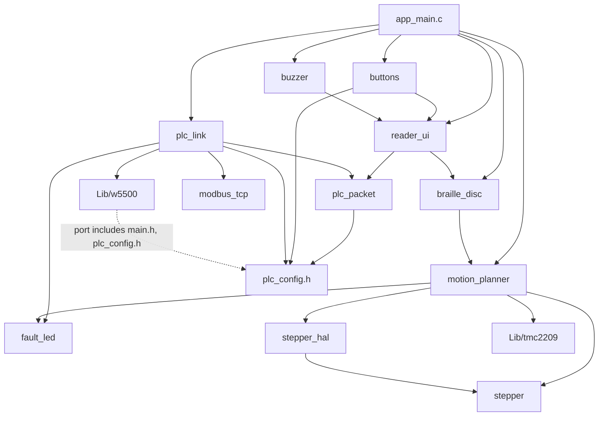

# 1. Architecture

This document describes how the firmware is organised: the layers between the
silicon and the application, the modules inside `App/`, how they depend on each
other, the two patterns that keep hardware access at the edges (core + port
libraries and `*_io_t` callback tables), and how the build selects between the
two input variants. Read it first; every other document assumes this map.

**Source files:** `CMakeLists.txt`, `cmake/stm32cubemx/CMakeLists.txt`,
`Core/Src/main.c`, `App/Src/app_main.c`, `App/Src/usb_device_stub.c`,
`Lib/tmc2209/`, `Lib/w5500/`, every file under `App/`.

## 1.1 Layers

```
┌───────────────────────────────────────────────────────────────────────┐
│ App/            application: reader, link, codec, encoding, motion,   │
│                 stepper, buttons, buzzer, fault LED                   │
├──────────────────────────────┬────────────────────────────────────────┤
│ Lib/tmc2209/   Lib/w5500/    │ Middlewares/ + USB_DEVICE/             │
│ vendored drivers, each a     │ ST USB device stack + CDC class        │
│ portable core + STM32 port   │ (USB_CDC variant only)                 │
├──────────────────────────────┴────────────────────────────────────────┤
│ Core/           CubeMX-generated: main(), clock tree, peripheral init,│
│                 interrupt vectors, HAL MSP callbacks                  │
├───────────────────────────────────────────────────────────────────────┤
│ Drivers/STM32F1xx_HAL_Driver   ST HAL                                 │
├───────────────────────────────────────────────────────────────────────┤
│ Drivers/CMSIS   Cortex-M3 core + STM32F103xB register definitions     │
├───────────────────────────────────────────────────────────────────────┤
│ Silicon: STM32F103C8 · 2× TMC2209 · W5500                             │
└───────────────────────────────────────────────────────────────────────┘
```

The layering describes ownership, not a strict call rule. Most `App/` code
goes through the HAL, but three places reach the registers directly because
the HAL call would be slower or less precise than required:

- `stepper_hal.c` writes DIR through `GPIOx->BSRR` and reads `RCC->CFGR` to
  derive the STEP timer clock; `buzzer.c` does the same for TIM4.
- `buttons.c` masks interrupts with `__get_PRIMASK()` / `__disable_irq()`
  around its read-and-clear operations.
- `Lib/tmc2209/tmc2209_stm32.c` drives the USART through CMSIS registers
  (`SR`, `DR`) and uses the DWT cycle counter for microsecond delays; the
  USART must still be initialised by `MX_USART2_UART_Init()` / `MX_USART3_UART_Init()`.

### CubeMX ownership

`single-cell-braille-controller.ioc` is the source of truth for pins, clocks
and peripheral configuration. Regenerating code from it rewrites `Core/`,
`cmake/stm32cubemx/CMakeLists.txt` and the `USB_DEVICE/` glue. Hand-written
code in those files survives only inside `/* USER CODE BEGIN … */` /
`/* USER CODE END … */` blocks. The firmware's own hooks into generated code
are all inside such blocks:

| File | Block | Content |
|---|---|---|
| `Core/Src/main.c` | `USER CODE 2` | `App_init(&huart2, &huart3, &htim2, &htim3, &htim4, &hspi2)` |
| `Core/Src/main.c` | `USER CODE 3` | `App_run()` inside the infinite loop |

Everything else the application needs from the generated code is reached by
name: the `*_Pin` / `*_GPIO_Port` macros in `Core/Inc/main.h`, the peripheral
handles, and the HAL weak callbacks (`HAL_GPIO_EXTI_Callback`,
`HAL_TIM_PWM_PulseFinishedCallback`) which `App/` overrides. The top-level
`CMakeLists.txt` is generated once and then owned by the project.

## 1.2 Modules

| Module | Role | Hardware it touches |
|---|---|---|
| `app_main.c` | Wiring layer: `App_init()`, `App_run()`, `HAL_GPIO_EXTI_Callback()`. Builds the callback tables that connect the other modules. One implementation per input variant. | none directly |
| `motion_planner.c` | Owns both motors: TMC2209 bring-up, the two stepper instances, angle → microstep moves, homing. Overrides `HAL_TIM_PWM_PulseFinishedCallback()`. | USART2/3 (via Lib/tmc2209), TIM2/TIM3, DIR/ENN/ZERO pins |
| `stepper.c` | Portable STEP/DIR core: step budget, position counter, busy flag. No MCU headers. | none (callbacks) |
| `stepper_hal.c` | STM32 port for `stepper.c`: STEP pulse train on a timer PWM channel, DIR on a GPIO. | TIM2/TIM3 registers, GPIO |
| `braille_disc.c` | Character → 6-dot pattern → two disc angles; UTF-8 decoder for the USB variant. | none (calls `move_to_angle()`) |
| `reader_ui.c` | Reading model: cursor, label/value sequencing, pending package slot, which sound to play. Pure logic. | none (callbacks) |
| `plc_packet.c` | Package contract: field table (coil, label), snapshot accessors. Pure logic. | none |
| `modbus_tcp.c` | Modbus TCP Read Coils request builder and strict response parser. Pure logic. | none |
| `plc_link.c` | W5500 bring-up, the TCP connection and the polling state machine. | SPI2 (via Lib/w5500), ETH pins |
| `buttons.c` | Debounced PREV/NEXT/REPEAT events from EXTI edges. | BTN pins |
| `buzzer.c` | Five blocking tone patterns on TIM4_CH1. | TIM4, PB6 |
| `fault_led.c` | Blocking boot-time blink codes on PC13. | LED pin |
| `usb_device_stub.c` | MODBUS variant only: no-op `MX_USB_DEVICE_Init()` and `hpcd_USB_FS` so generated USB references still link. | none |

`plc_config.h` holds every deployment setting (network identity, PLC endpoint,
coil range, timings). `braille_disc.h` holds the disc position angles and the
value-glyph constants.

## 1.3 Dependencies

Arrows read "includes / calls". Only project headers are shown.



Notes on the edges that are easy to misread:

- `buttons.h` and `buzzer.h` include `reader_ui.h` only for the
  `reader_event_t` and `reader_sound_t` types; neither calls the reader.
- `reader_ui.c` includes `braille_disc.h` only for `BRAILLE_DOTS_ALL_FLAT` /
  `BRAILLE_DOTS_ALL_RAISED`; it renders through its callback table.
- `Lib/w5500/w5500_stm32.c` reaches upward: it includes `main.h` for the
  `ETH_*` pin macros and `plc_config.h` for the reset timings, and
  `Lib/w5500/CMakeLists.txt` adds `App/Inc` and `Core/Inc` to its private
  include path. The TMC2209 port has no such dependency.

## 1.4 Two patterns that keep hardware at the edges

### Core + port

Three components split portable logic from MCU access:

| Component | Portable core | STM32 port | Seam |
|---|---|---|---|
| Stepper | `stepper.c` / `stepper.h` | `stepper_hal.c` / `stepper_hal.h` | `Stepper_Hal_t` (DIR write, optional enable write, pulse-train start/stop, context) |
| TMC2209 | `Lib/tmc2209/tmc2209.c` | `Lib/tmc2209/tmc2209_stm32.c` | `tmc2209_hal_t` (serial write/available/read/flush, µs and ms delay, enable pin, context) |
| W5500 | `Lib/w5500/ioLibrary/Ethernet/*` | `Lib/w5500/w5500_stm32.c` | ioLibrary's registered callbacks (chip select, byte and burst SPI, critical section) |

The core never includes an MCU header; the port fills a struct of function
pointers with its own static functions plus a `context` pointer to its
per-instance state. One port instance exists per hardware instance (one per
motor for the stepper and the TMC2209).

### `*_io_t` callback tables

The application modules that make decisions are wired together through tables
of function pointers, filled in `app_main.c`:

| Table | Owner | Filled with |
|---|---|---|
| `reader_ui_io_t` | `reader_ui` | `braille_render_char`, `braille_render_dots`, `buzzer_play`, `plc_link_request_now`, `HAL_GetTick` |
| `plc_link_io_t` | `plc_link` | `reader_ui_on_snapshot`, `reader_ui_on_link_fault` |

Because `reader_ui` sees the cell, the buzzer, the link and the clock only
through `reader_ui_io_t`, the host test (`tests/test_reader_ui.c`) drives it
with recording fakes. The same seam is where a second protocol plugs in; see
[11-adding-a-protocol.md](11-adding-a-protocol.md).

## 1.5 Build variants

The input source is chosen at configure time with the CMake cache variable
`BRAILLE_INPUT`:

| Value | Compile definition | What `app_main.c` builds |
|---|---|---|
| `MODBUS` (default) | `BRAILLE_INPUT_MODBUS` | PLC reader: `plc_link`, `reader_ui`, `buttons`, `buzzer` |
| `USB_CDC` | `BRAILLE_INPUT_USB_CDC` | Bench variant: characters typed into a USB virtual COM port are rendered directly ([14-usb-cdc-variant.md](14-usb-cdc-variant.md)) |

Any other value stops the configure step with `FATAL_ERROR`; the comparison is
case-sensitive.

For `MODBUS`, `CMakeLists.txt` edits the generated target after the fact,
because `cmake/stm32cubemx/CMakeLists.txt` is regenerated by CubeMX:

1. sources matching `/USB_DEVICE/` are removed from the target;
2. `USB_Device_Library` is removed from its link libraries and marked
   `EXCLUDE_FROM_ALL`;
3. `App/Src/usb_device_stub.c` provides the two symbols generated code still
   references outside any USER CODE block: `MX_USB_DEVICE_Init()` (called
   from `main()`) and `hpcd_USB_FS` (used by `USB_LP_CAN1_RX0_IRQHandler`).
   The USB interrupt is never enabled in this variant.

All application sources are picked up by a glob on `App/Src/*.c`; a new module
needs no CMake change. `Lib/tmc2209` and `Lib/w5500` are static libraries
added with `add_subdirectory` and linked into the executable; both are always
built, in both variants.
