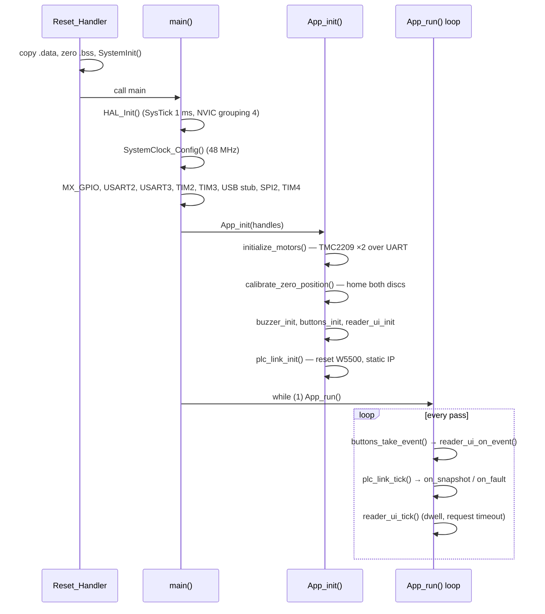

# 3. Execution flow

This document traces what the firmware does from reset to a rendered braille
cell in the default MODBUS build: the start-up sequence, the initialisation
order, the cooperative main loop, what each interrupt does, and every place
the loop blocks and for how long. Bugs in timing, missed buttons or late polls
are diagnosed from this document. The USB_CDC variant's flow is in
[14-usb-cdc-variant.md](14-usb-cdc-variant.md).

**Source files:** `startup_stm32f103xb.s`, `Core/Src/main.c`,
`App/Src/app_main.c`, `App/Src/motion_planner.c`, `App/Src/plc_link.c`,
`App/Src/reader_ui.c`, `App/Src/buttons.c`, `App/Src/buzzer.c`,
`App/Src/fault_led.c`, `App/Src/stepper.c`, `App/Src/stepper_hal.c`.

## 3.1 Overview

## 3.2 From reset to `main()`

`Reset_Handler` (in `startup_stm32f103xb.s`) copies `.data` from flash to RAM,
zeroes `.bss`, calls `SystemInit()` and then `main()`. The core runs from the
internal 8 MHz HSI until `SystemClock_Config()` switches to the PLL.

## 3.3 `main()`

The order is generated by CubeMX and must not be relied on beyond what is
listed here:

1. `HAL_Init()` — flash prefetch, NVIC priority grouping 4, SysTick at 1 kHz
   with priority 15.
2. `SystemClock_Config()` — HSE × 6 = 48 MHz; see
   [02-mcu-resources.md](02-mcu-resources.md#21-clock-tree).
3. `MX_GPIO_Init()` — pins to their boot levels: both ENN high (drivers
   disabled), `ETH_NSS` high, `ETH_RESET` high, DIR and LED low; EXTI 5–9
   enabled.
4. `MX_USART2_UART_Init()`, `MX_USART3_UART_Init()` — TMC2209 UARTs.
5. `MX_TIM2_Init()`, `MX_TIM3_Init()` — STEP timers (configured, not started).
6. `MX_USB_DEVICE_Init()` — a no-op in the MODBUS build
   (`usb_device_stub.c`).
7. `MX_SPI2_Init()` — W5500 bus.
8. `MX_TIM4_Init()` — buzzer timer (configured, not started).
9. `App_init(&huart2, &huart3, &htim2, &htim3, &htim4, &hspi2)`.
10. `while (1) { App_run(); }`.

## 3.4 `App_init()`

`App_init()` in `app_main.c` runs four stages in a fixed order. None of them
halts start-up on failure; each failure blinks a code on the LED and start-up
continues, so the operator keeps whatever still works.

### 3.4.1 Motor drivers — `initialize_motors()`

For each motor, in order 01 then 02:

1. ENN is driven high again (driver disabled), independent of the CubeMX
   default.
2. `motor_driver_init()`:
   - `tmc2209_stm32_hal_init()` binds the TMC2209 library to the USART and
     the ENN pin and enables the DWT cycle counter;
   - waits `APP_DRIVER_POWER_UP_MS` (200 ms);
   - `tmc2209_setup()` switches the driver to UART control at serial address
     0 and loads the library defaults (driver left disabled, minimum current);
   - enables automatic current scaling and gradient adaptation, sets
     `APP_MICROSTEPS` (8), run and hold current (`APP_RUN_CURRENT_PERCENT`,
     `APP_HOLD_CURRENT_PERCENT`, both 25 %), then `tmc2209_enable()`, which
     pulls ENN low;
   - returns `tmc2209_is_setup_and_communicating()`: a register read-back
     over UART. On `false`, `fault_led_blink(FAULT_LED_CODE_MOTOR_0x)` runs.
     The driver still turns in that case, because the STEP/DIR interface does
     not depend on the UART.
3. After both drivers: `motor_stepper_init()` binds each `Stepper_t` to its
   STEP timer channel (TIM2_CH2, TIM3_CH4) and DIR pin, with
   `APP_MOTOR_DIR_INVERTED`; then `tmc2209_move_using_step_dir_interface()`
   writes VACTUAL = 0 so the drivers follow STEP/DIR.

Details of what is written to each driver: [04-tmc2209.md](04-tmc2209.md).

### 3.4.2 Homing — `calibrate_zero_position()`

Each disc in turn is driven to the edge of its ZERO sensor's tab and its
position counter is set to `APP_ZERO_POSITION_STEPS` (0). A disc that fails
blinks code 1 or 2 and is left unhomed; start-up continues. The return value is
ignored by `App_init()`. The sequence and its bounds are in
[05-motion-and-homing.md](05-motion-and-homing.md#56-homing).

### 3.4.3 Operator interface

`buzzer_init()` stores the TIM4 handle and channel and computes the timer tick
from the clock tree. It runs before the link so that a missing W5500 can be
announced by sound from inside `plc_link_init()`. `buttons_init()` arms the
three buttons; `reader_ui_init()` stores the callback table and enters
`NO_DATA` with a blank cursor.

### 3.4.4 Network — `plc_link_init()`

Resets the W5500 (`ETH_RESET` low for `PLC_W5500_RESET_LOW_MS`, then
`PLC_W5500_BOOT_MS` of boot time), registers the SPI callbacks, checks that
`VERSIONR` reads `0x04`, allocates the socket buffers and applies the static
network identity from `plc_config.h`. On success the link enters `LINK_WAIT`.
On failure it blinks `FAULT_LED_CODE_ETHERNET` (3), reports a fault to the
reader (which plays the link-fault sound) and enters `CHIP_FAULT`, from which
it retries in the background. See [07-w5500.md](07-w5500.md) and
[08-modbus-tcp.md](08-modbus-tcp.md).

## 3.5 The main loop — `App_run()`

`App_run()` is a cooperative tick with three steps, always in this order:

1. **Buttons.** `buttons_take_event()` re-arms released buttons and returns at
   most one pending event, in priority order NEXT, PREV, REPEAT. A non-`NONE`
   event goes to `reader_ui_on_event()`, which may render a glyph (blocking
   while the discs turn) or play a sound (blocking for the pattern).
2. **Link.** `plc_link_tick()` advances the link state machine by one step.
   When a response is validated it calls `reader_ui_on_snapshot()`; on a
   fault it calls `reader_ui_on_link_fault()`. Both may render or play a
   sound, inside this call.
3. **Reader.** `reader_ui_tick()` advances the label sequence when the dwell
   (`PLC_LABEL_DWELL_MS`, 1500 ms) has elapsed and times out an explicit
   request after `PLC_RESPONSE_TIMEOUT_MS`.

Buttons come first because they are the only thing a person is waiting on;
the link next so a due poll leaves promptly; the reader last because its work
is timer-driven and a late pass costs nothing.

There is no scheduler and no RTOS. All time is measured with `HAL_GetTick()`
and unsigned subtraction, so the 32-bit millisecond counter can wrap (after
about 49.7 days) without breaking any interval.

## 3.6 Interrupts at run time

| Source | What runs in the ISR | What the main loop does with it |
|---|---|---|
| TIM2 / TIM3 compare (end of each STEP pulse) | `Stepper_OnPulseComplete()`: position ±1, remaining −1, stop the train at 0 | `wait_until_idle()` / `seek_sensor()` spin on `Stepper_IsBusy()` |
| EXTI PB7/PB8/PB9 (button falling edge) | `buttons_on_exti()`: stamp the edge time; if armed, disarm and set `pending` | `buttons_take_event()` takes `pending`, re-arms after a quiet release |
| EXTI PB5 (W5500 INT) | `plc_link_on_exti()`: sets `irq_pending` | nothing: the W5500 interrupt sources are masked and `irq_pending` is never read |
| SysTick | `HAL_IncTick()` | every timeout and dwell |

## 3.7 Blocking budget

Every call that blocks the loop, with its bound computed from the constants
that set it:

| Where | Bound | Derived from | When |
|---|---|---|---|
| `move_to_angle()` (every glyph) | ≤ 0.5 s | shortest path ≤ half a turn = 800 microsteps at `APP_STEP_RATE_HZ` = 1600 Hz | each render |
| `buzzer_play()` | ≤ 480 ms | longest pattern (`LINK_FAULT`: 200 + 80 + 200 ms) | each sound |
| `chip_bring_up()` | ≈ 12 ms + SPI traffic | `PLC_W5500_RESET_LOW_MS` (2) + `PLC_W5500_BOOT_MS` (10) | init, and each `CHIP_FAULT` retry every `PLC_RECONNECT_DELAY_MS` |
| `drain_socket()` | ≤ 512 reads of ≤ 32 B | `PLC_DRAIN_MAX_CHUNKS`, `PLC_FRAME_BUFFER_LEN` | after a rejected, oversized or late response |
| W5500 SPI transfer | ≤ 100 ms per transfer if the bus hangs | `W5500_SPI_TIMEOUT_MS`; a healthy transfer takes microseconds | every chip access |
| `motor_driver_init()` | 200 ms + UART transactions | `APP_DRIVER_POWER_UP_MS` | init only |
| `calibrate_zero_position()` | ≤ ~25.6 s per disc | see [05-motion-and-homing.md](05-motion-and-homing.md#57-bounds) | init only |
| `fault_led_blink(n)` | 3 × (n × 300 + 800) ms: 3.3 s (code 1), 4.2 s (code 2), 5.1 s (code 3) | `FAULT_LED_BURSTS`, `FAULT_LED_ON_MS` + `FAULT_LED_OFF_MS`, `FAULT_LED_GAP_MS` | init only |

Consequences:

- **Poll timing is a floor, not a guarantee.** A poll falls due every
  `PLC_POLL_INTERVAL_MS` (500 ms), but it is sent only when the loop reaches
  `plc_link_tick()`. A render (≤ 0.5 s) plus a sound (≤ 0.48 s) in the same
  pass can postpone it by about 1 s. The same applies to the response timeout
  and the label dwell, which can only expire late, never early.
- **A slow reply can be reported as a timeout even though it arrived.** The
  timeout is checked after `read_response()` in the same tick, so a reply that
  arrived during a long block is read first; only a reply still missing when
  the tick runs counts as late.

## 3.8 Button presses during a block

While the loop is blocked, the button ISR still runs:

- The **first** press of a button sets its `pending` flag and disarms it.
  The press is acted on when the loop returns to `buttons_take_event()`.
- Further presses of the **same** button before it has been released and seen
  quiet for `PLC_BUTTON_RELEASE_STABLE_MS` (40 ms) do nothing: the button is
  disarmed, and re-arming only happens in the main loop. Three taps of NEXT
  during one disc move therefore advance one field, by design.
- Presses of **different** buttons each set their own flag; they are delivered
  one per loop pass in the order NEXT, PREV, REPEAT, not in the order they were
  pressed.
- A press while the reader waits for an explicit poll (`AWAITING_POLL`) is
  delivered by `buttons` but ignored by `reader_ui_on_event()`.

## 3.9 One microstep, down to the registers

Rendering the letter `a` (dot 1) from the space character moves disc 1 by one
position and leaves disc 2 in place:

1. `braille_render_char('a')` folds to `'A'`, looks up `DOT1`, and
   `braille_render_dots()` computes disc 1 weight 1 → angle 225 (22.5°) and
   disc 2 weight 0 → angle 0.
2. `move_to_angle()` calls `steps_to_angle()` for each disc: disc 1 target =
   225 × 1600 / 3600 = 100 microsteps, current 0, delta +100; disc 2 delta 0,
   so no train starts for it.
3. `start_move()` → `Stepper_SetDirection(forward)` writes DIR (inverted at the
   pin by `APP_MOTOR_DIR_INVERTED`), then `Stepper_MoveSteps(100, 1600)` sets
   `remaining = 100` and calls `pulse_train_start(1600)`.
4. `pulse_train_start()` computes `ticks = 1 000 000 / 1600 = 625`, writes
   `ARR = 624` and `CCR2 = 312` (50 % duty), forces an update event so the
   preloaded values take effect, clears `SR`, and starts the channel with
   `HAL_TIM_PWM_Start_IT()`. STEP goes high immediately (PWM mode 1, counter
   at 0).
5. At counter = 312 the compare match drives STEP low and raises the CC2
   interrupt: `HAL_TIM_PWM_PulseFinishedCallback()` →
   `Stepper_OnPulseComplete()`: `position = 1`, `remaining = 99`.
6. After the 100th callback `remaining` reaches 0 and `pulse_train_stop()`
   disables the channel. `wait_until_idle()` sees both steppers idle and
   returns, about 62.5 ms after it started.
