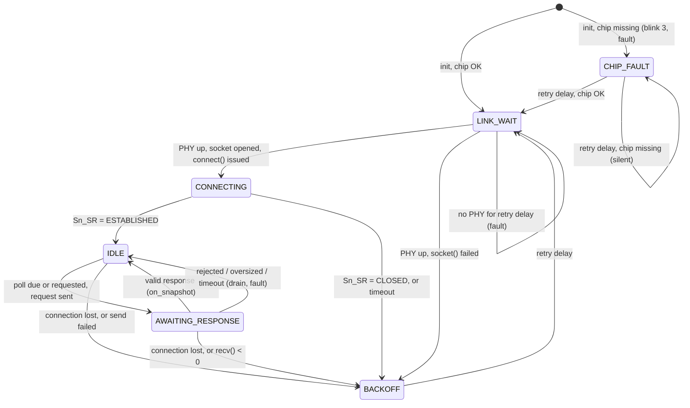

# 8. Modbus TCP and the PLC link

This document describes how the device obtains the PLC's signals: the polling
model, the exact request and response frames, the strict response parser, the
`plc_link` state machine with every transition, the configuration in
`plc_config.h`, and how to diagnose a link that does not work. The chip
underneath is described in [07-w5500.md](07-w5500.md); what the reader does
with a package is in [09-reader-ui.md](09-reader-ui.md).

**Source files:** `App/Src/plc_link.c`, `App/Inc/plc_link.h`,
`App/Src/modbus_tcp.c`, `App/Inc/modbus_tcp.h`, `App/Src/plc_packet.c`,
`App/Inc/plc_packet.h`, `App/Inc/plc_config.h`, `tests/test_modbus_tcp.c`,
`tests/test_plc_packet.c`, `tools/plc_sim.py`.

## 8.1 Polling model

The device is always the **Modbus TCP client**. It opens the TCP connection to
the PLC and sends every request; the PLC only answers. Modbus gives a server no
way to push data, so the device detects a change by asking repeatedly:

- Every `PLC_POLL_INTERVAL_MS` (500 ms) it sends one Read Coils request for the
  whole package (`PLC_COIL_COUNT` = 11 coils from `PLC_COIL_BASE_ADDRESS` = 0).
- A request can also be sent at once, out of cycle, when the reader asks for
  one (`plc_link_request_now()`).
- Each validated response is handed to the reader as a `plc_snapshot_t`
  through `on_snapshot`. The reader compares it with the package it holds;
  "the PLC changed something" means "the latest poll differs".

Consequences: a change on the PLC becomes visible at the next poll, up to
500 ms later plus the loop's blocking time
([03-execution-flow.md](03-execution-flow.md#37-blocking-budget)); and a lost or
late reply costs latency, never correctness, because the next poll asks again.
A pulse on a coil shorter than the polling period can be missed entirely.

Connecting to the PLC requires no gateway and no change to the PLC program:
the device sits on the same Ethernet segment with a static address and reads
coils the PLC already exposes.

## 8.2 Frames

All multi-byte fields are big-endian. Offsets are the `MB_OFF_*` constants in
`modbus_tcp.c`.

### Request — 12 bytes, built by `modbus_build_read_coils()`

| Offset | Field | Value |
|---|---|---|
| 0–1 | Transaction id | incremented before every request (wraps) |
| 2–3 | Protocol id | 0 |
| 4–5 | Length (bytes that follow) | 6 |
| 6 | Unit id | `PLC_UNIT_ID` (1) |
| 7 | Function code | `0x01` Read Coils |
| 8–9 | Starting address | `PLC_COIL_BASE_ADDRESS` (0) |
| 10–11 | Quantity | `PLC_COIL_COUNT` (11) |

Example (transaction 0x0007): `00 07 00 00 00 06 01 01 00 00 00 0B`.

### Response — `MODBUS_READ_COILS_RSP_LEN(11)` = 11 bytes

| Offset | Field | Value |
|---|---|---|
| 0–1 | Transaction id | must equal the request's |
| 2–3 | Protocol id | must be 0 |
| 4–5 | Length | must equal bytes received − 6 (5 here) |
| 6 | Unit id | must equal `PLC_UNIT_ID` |
| 7 | Function code | `0x01`; `0x81` is an exception reply |
| 8 | Byte count | must equal ⌈11 / 8⌉ = 2 |
| 9 | Coils 0–7 | bit 0 = coil 0 |
| 10 | Coils 8–10 | bit 0 = coil 8; bits 3–7 are padding |

Coil bits are packed least-significant bit first. The parser assembles them
into `bits` (`bits = byte9 | byte10 << 8`) and masks off the padding, so a
server that sets unused bits cannot invent signals. Example: data bytes
`0x90 0x00` set coils 4 and 7.

An exception reply is 9 bytes: function `0x81`, then the exception code at
offset 8.

## 8.3 The strict parser — `modbus_parse_read_coils()`

The parser accepts a frame only if it is the answer to the request just sent.
Checks, in order, with the status returned on failure:

| Check | Status |
|---|---|
| null pointer, quantity 0 or > 16 | `MODBUS_ERR_INVALID_ARGUMENT` |
| fewer than 9 bytes | `MODBUS_ERR_TOO_SHORT` |
| protocol id ≠ 0 | `MODBUS_ERR_PROTOCOL_ID` |
| transaction id ≠ expected | `MODBUS_ERR_TRANSACTION_ID` |
| unit id ≠ expected | `MODBUS_ERR_UNIT_ID` |
| MBAP length ≠ bytes received − 6 | `MODBUS_ERR_LENGTH_FIELD` |
| function code = `0x81` | `MODBUS_ERR_EXCEPTION` (exception code returned) |
| function code ≠ `0x01` | `MODBUS_ERR_FUNCTION` |
| byte count ≠ ⌈quantity / 8⌉ | `MODBUS_ERR_BYTE_COUNT` |
| frame shorter than the full response | `MODBUS_ERR_TOO_SHORT` |

Why so strict: a frame that decodes cleanly but answers a different request
(a late reply to an earlier poll, a reply from another unit) would hand the
reader values that are not current. The transaction id is what ties a reply to
its request.

`modbus_tcp.c` contains no socket code. Every rejection path is exercised by
`tests/test_modbus_tcp.c` with hand-built byte arrays.

## 8.4 The link state machine — `plc_link.c`

`plc_link_tick()` runs once per main-loop pass and returns without blocking
(except `chip_bring_up()`, about 12 ms). All failures funnel through
`fail_to_backoff()` (close the socket, report a fault, enter `BACKOFF`) or,
when the TCP connection itself is still healthy, back to `IDLE` after
draining the socket.

| From | Event / guard | To | Action |
|---|---|---|---|
| (init) | `chip_bring_up()` true | `LINK_WAIT` | — |
| (init) | `chip_bring_up()` false | `CHIP_FAULT` | `fault_led_blink(3)`, report fault |
| `CHIP_FAULT` | `PLC_RECONNECT_DELAY_MS` elapsed, bring-up true | `LINK_WAIT` | — |
| `CHIP_FAULT` | `PLC_RECONNECT_DELAY_MS` elapsed, bring-up false | `CHIP_FAULT` | restart the delay; **no** fault report |
| `LINK_WAIT` | `wizphy_getphylink() == PHY_LINK_ON`, `socket()` returns 0 | `CONNECTING` | non-blocking `connect()` |
| `LINK_WAIT` | PHY up, `socket()` fails | `BACKOFF` | close, report fault |
| `LINK_WAIT` | PHY down for `PLC_RECONNECT_DELAY_MS` | `LINK_WAIT` | report fault, restart the delay |
| `CONNECTING` | `Sn_SR == SOCK_ESTABLISHED` | `IDLE` | first poll one interval later |
| `CONNECTING` | `Sn_SR == SOCK_CLOSED` | `BACKOFF` | close, report fault |
| `CONNECTING` | `PLC_RESPONSE_TIMEOUT_MS` elapsed | `BACKOFF` | close, report fault |
| `IDLE` | `Sn_SR != SOCK_ESTABLISHED` | `BACKOFF` | close, report fault |
| `IDLE` | poll requested, or `PLC_POLL_INTERVAL_MS` since the last poll | `AWAITING_RESPONSE` | build and `send()` the request; clear the request flag |
| `IDLE` | request build or `send()` fails | `BACKOFF` | close, report fault |
| `AWAITING_RESPONSE` | `Sn_SR != SOCK_ESTABLISHED` | `BACKOFF` | close, report fault |
| `AWAITING_RESPONSE` | fewer bytes than a full response | — | wait |
| `AWAITING_RESPONSE` | more bytes than `PLC_FRAME_BUFFER_LEN` (32) queued | `IDLE` | drain, report fault |
| `AWAITING_RESPONSE` | `recv()` returns 0 (busy) | — | retry next tick |
| `AWAITING_RESPONSE` | `recv()` < 0 | `BACKOFF` | close, report fault |
| `AWAITING_RESPONSE` | parser rejects the frame | `IDLE` | drain, report fault |
| `AWAITING_RESPONSE` | parser accepts | `IDLE` | `on_snapshot(bits)` |
| `AWAITING_RESPONSE` | `PLC_RESPONSE_TIMEOUT_MS` elapsed after the read attempt | `IDLE` | drain, report fault |
| `BACKOFF` | `PLC_RECONNECT_DELAY_MS` elapsed | `LINK_WAIT` | — |

### Draining — `drain_socket()`

Whenever the byte stream may no longer start on a frame boundary (a rejected
frame, an oversized backlog, a request that timed out), the socket's receive
buffer is emptied in chunks of up to 32 bytes, at most `PLC_DRAIN_MAX_CHUNKS`
(512) times. Without this a late reply could sit in the buffer and merge with
the next response; the parser would reject the merged frame over its stale
transaction id, and the link would stay desynchronised indefinitely because the
TCP connection itself is healthy and nothing else would reopen it.

### Fault reporting

`report_fault()` calls the `on_fault` callback. The link reports every failure
it sees, at most once per tick; it does not rate-limit. The reader decides
how often a fault is actually heard
(`PLC_FAULT_SOUND_MIN_INTERVAL_MS`, [10-sound-feedback.md](10-sound-feedback.md)).
With the cable unplugged, `LINK_WAIT` reports every `PLC_RECONNECT_DELAY_MS`;
with no PLC answering, each `CONNECTING` timeout plus `BACKOFF` cycle
(about 3 s) reports once. `CHIP_FAULT` retries are silent after the first
report.

### Requests from the reader

`plc_link_request_now()` sets a flag that `IDLE` honours on its next tick. It
is ignored while `AWAITING_RESPONSE` (the reply already in flight serves the
same purpose). If the link is not in `IDLE` (connecting, backing off) the flag
waits; the reader times out its own wait after `PLC_RESPONSE_TIMEOUT_MS` and
treats it as a fault.

## 8.5 Configuration — `plc_config.h`

All deployment settings live in this header; there is no run-time
configuration. Edit and reflash.

| Constant(s) | Default | Meaning |
|---|---|---|
| `PLC_DEVICE_MAC_0` … `_5` | `00:08:DC:11:22:33` | Device MAC (WIZnet OUI `00:08:DC`). Must be unique on the segment. |
| `PLC_DEVICE_IP_0` … `_3` | 10.0.0.50 | Device static IP |
| `PLC_DEVICE_MASK_0` … `_3` | 255.255.255.0 | Subnet mask |
| `PLC_GATEWAY_0` … `_3` | 10.0.0.1 | Gateway (also written as DNS, unused) |
| `PLC_SERVER_IP_0` … `_3` | 10.0.0.204 | PLC address |
| `PLC_SERVER_PORT` | 503 | PLC Modbus TCP port (the installation uses 503, not the standard 502) |
| `PLC_LOCAL_PORT` | 50000 | Device source port |
| `PLC_UNIT_ID` | 1 | Modbus unit id |
| `PLC_COIL_BASE_ADDRESS` | 0 | First coil of the package |
| `PLC_COIL_COUNT` | 11 | Coils per package |
| `PLC_SOCKET_NUMBER` | 0 | W5500 socket |
| `PLC_LABEL_DWELL_MS` | 1500 | Time each label letter is shown |
| `PLC_POLL_INTERVAL_MS` | 500 | Background poll period |
| `PLC_RESPONSE_TIMEOUT_MS` | 1000 | Connect timeout and reply timeout |
| `PLC_RECONNECT_DELAY_MS` | 2000 | Pause in `BACKOFF`, `CHIP_FAULT` retry period, no-cable report period |
| `PLC_W5500_RESET_LOW_MS` | 2 | RSTn low time |
| `PLC_W5500_BOOT_MS` | 10 | Wait after RSTn release |
| `PLC_QUEUED_SOUND_MIN_INTERVAL_MS` | 5000 | Minimum spacing of the "newer data" sound |
| `PLC_FAULT_SOUND_MIN_INTERVAL_MS` | 10000 | Minimum spacing of the link-fault sound |
| `PLC_BUTTON_RELEASE_STABLE_MS` | 40 | Quiet time before a released button re-arms |

### Moving the device to another network or PLC

1. Set the device IP, mask and gateway to an address on the PLC's subnet; give
   it a unique MAC if more than one device shares the segment.
2. Set `PLC_SERVER_IP_*`, `PLC_SERVER_PORT` and `PLC_UNIT_ID` to the PLC's.
3. Rebuild and flash; check with ARP/ping ([13-build-test-debug.md](13-build-test-debug.md)).

### Changing the package

The package is limited to 16 coils (`plc_snapshot_t` holds them in a
`uint16_t`; `MODBUS_MAX_COILS` = 16). To read a different block:

1. Set `PLC_COIL_BASE_ADDRESS` and `PLC_COIL_COUNT`.
2. Set `PLC_FIELD_COUNT` in `plc_packet.h` to the same value and rewrite the
   `plc_fields[]` table in `plc_packet.c`: one row per field with its absolute
   coil address, label length and one or two label letters.
3. The build enforces the coupling: `_Static_assert`s fail if
   `PLC_FIELD_COUNT != PLC_COIL_COUNT`, if `PLC_COIL_COUNT > 16`, or if
   `PLC_LABEL_MAX_GLYPHS` changes.
4. Respect the label rules in [09-reader-ui.md](09-reader-ui.md#93-labels), then
   update `tests/test_plc_packet.c` and run `make -C tests`.

Each extra coil adds one value glyph and its label letters to a full read;
at 1500 ms per letter plus up to 0.5 s per disc move, reading time grows by
about 2–4 s per field.

## 8.6 The package contract — `plc_packet`

| Type / function | Meaning |
|---|---|
| `plc_snapshot_t` | `uint16_t bits`; bit *n* = coil `PLC_COIL_BASE_ADDRESS + n` |
| `plc_field_t` | `coil` (absolute address), `glyph_count` (1–2), `label[2]` (ASCII letters) |
| `plc_packet_field(index)` | Field descriptor in reading order, or `NULL` past the end |
| `plc_snapshot_bit(snapshot, index)` | Value of field `index` |
| `plc_snapshot_equal(a, b)` | Whole-package comparison |

Reading order is table order; it does not have to follow coil order.

## 8.7 Diagnosing the link

| Symptom | Likely state | Check |
|---|---|---|
| Blink code 3 at start-up | `CHIP_FAULT` | SPI wiring, [07-w5500.md](07-w5500.md#78-troubleshooting-the-chip) |
| Link-fault sound every ~10 s, RJ45 LEDs off | `LINK_WAIT` | cable, switch port |
| Link-fault sound every ~10 s, device answers ping, `who-has <PLC IP>` ARP requests from the device | `CONNECTING` → `BACKOFF` | PLC address, PLC on the same subnet, PLC powered |
| ARP resolves but connection refused or reset | `CONNECTING` → `BACKOFF` | `PLC_SERVER_PORT` (503 vs 502), PLC Modbus server enabled |
| Connected, but faults on every poll | `AWAITING_RESPONSE` → `IDLE` | unit id, coil range valid on the PLC (an exception reply is a fault), capture a frame and compare with section 8.2 |
| No sound at all, no ARP traffic from the device | firmware not running the link | reflash; check the boot sequence ([13-build-test-debug.md](13-build-test-debug.md)) |

The PLC simulator in `tools/plc_sim.py` stands in for the PLC on a bench PC;
its use is described in [13-build-test-debug.md](13-build-test-debug.md).
